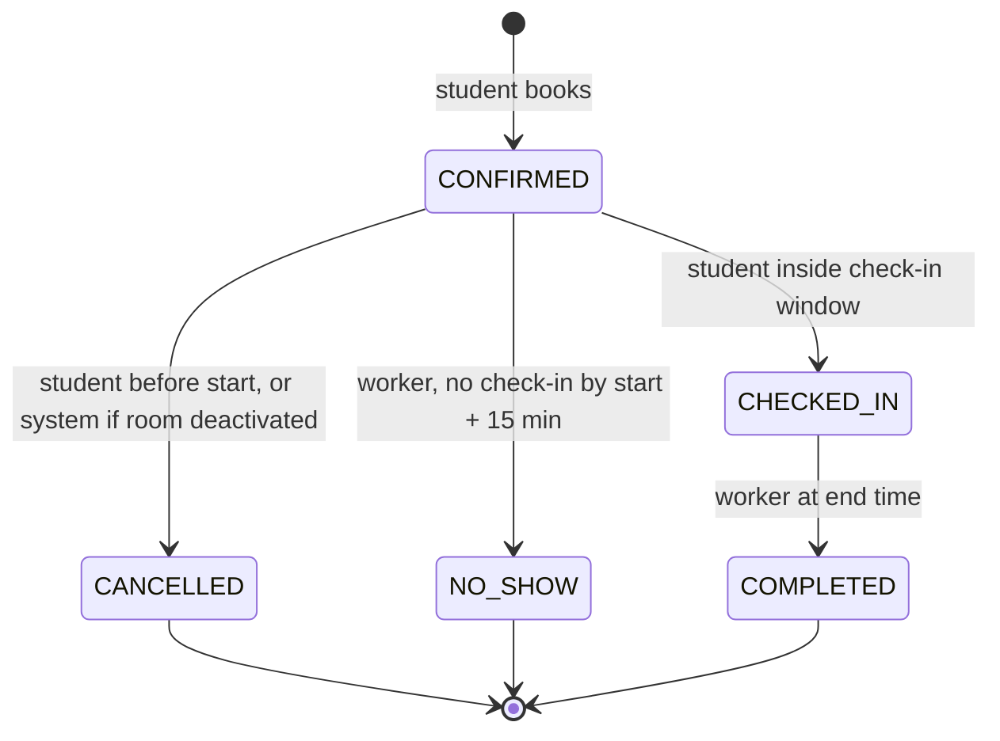

# Data model

One relational database (PostgreSQL) holds everything. Availability is never stored; it is derived from bookings and opening hours. The overlap rule lives in the database as a constraint, so no code path can break it.

The exact table and column names to use are in the [schema contract](../schema-contract.md).

## Entities

| Entity | Key (who creates it) | Main fields | Links |
| --- | --- | --- | --- |
| Student | `student_id` (from SSO) | email, display_name, suspended_until | 1 to many Bookings, Penalties, Notifications |
| Building | `building_id` (import) | name, zone, latitude, longitude | 1 to many Rooms |
| Room | `room_id` UUID (import); `code` unique, e.g. ENG-201 | name, type, capacity, opens_at, closes_at, is_active | many Rooms to 1 Building; many to many Amenities |
| Amenity | `amenity_id` (import) | name (projector, whiteboard, power sockets) | many to many Rooms via RoomAmenity |
| RoomAmenity | (`room_id`, `amenity_id`) | none | join table |
| Booking | `booking_id` UUID (service) | room_id, student_id, during (start, end), purpose, status, idempotency_key, checked_in_at, cancelled_at, created_at | many to 1 Room, many to 1 Student |
| BookingEvent | `event_id` (service) | booking_id, from_status, to_status, actor (student or system), at | many to 1 Booking (audit trail) |
| Penalty | `penalty_id` (worker) | student_id, booking_id, kind = no_show, at | 0 or 1 per Booking |
| Notification (outbox) | `notification_id` (service or worker) | student_id, booking_id, type, send_at, sent_at, attempts, dedupe_key | many to 1 Student |
| Announcement | `announcement_id` (ops) | starts_at, ends_at, message | none |
| Policy | key | value | read by service and worker |

## Booking states

| From | To | Who | Allowed when |
| --- | --- | --- | --- |
| (new) | CONFIRMED | Student | All booking rules pass |
| CONFIRMED | CANCELLED | Student | Before start |
| CONFIRMED | CANCELLED | System | Room deactivated (reason recorded) |
| CONFIRMED | CHECKED_IN | Student | Inside the check-in window |
| CONFIRMED | NO_SHOW | Worker | No check-in by start + 15 min |
| CHECKED_IN | COMPLETED | Worker | At end time |

CANCELLED, NO_SHOW and COMPLETED are final. **Active** means CONFIRMED or CHECKED_IN. Any other change is refused.

## Rules that must always hold

These are enforced **in the database**.

1. No two active bookings for the same room overlap. Exclusion constraint on `(room_id =, during &&)` where status is active. Ranges are half-open, so 10:00 to 11:00 and 11:00 to 12:00 do not clash.
2. A student has at most one active booking per room. Partial unique index on `(student_id, room_id)` where status is active.
3. One booking per `(student_id, idempotency_key)`. Unique index.
4. End after start, and status is one of the allowed values. Check constraints.

Rules that need policy values (grid, duration, hours, horizon, weekly limit, suspension) live in the service, checked inside the same transaction as the insert.

## Answers to the data questions

| Question | Answer |
| --- | --- |
| What must the system remember? | Students (id and standing only), buildings, rooms, amenities, bookings and their history, penalties, notifications, announcements, policy. |
| What identifies each thing, and who creates it? | Student id from SSO. Room, building and amenity ids from the facilities import. Booking, event, penalty and notification ids are UUIDs made by the service. The client never invents ids except the idempotency key. |
| How are things linked? | Student 1 to many Booking. Room 1 to many Booking. Building 1 to many Room. Room many to many Amenity. Booking 1 to many BookingEvent. Booking 0 or 1 Penalty. |
| Start and end time, or fixed slots? | Start and end time, constrained to a 30 min grid. Stored as one time range column. |
| What states, which changes? | See booking states above. |
| Delete or keep cancelled bookings? | Keep. They feed the audit trail, the weekly limit, penalties and the Just released list. Retention period is an open question (proposed 1 year). |
| What rule must always hold? | No overlapping active bookings for one room. Enforced by the database. |
| Store or derive availability? | Derive. Free = open hours minus active bookings. Storing it would create a second truth that can disagree. |
| What time form? | UTC timestamps (`timestamptz`). Grid and week boundaries are computed in campus local time; the UI shows local time. |
| Which search fields, what does the query touch? | Room filters hit the rooms table (about 300 rows, indexed on type, capacity, building). The time filter is an anti-join on bookings using a GiST index on `(room_id, during)`, touching only bookings in the requested window. |
| Who may read or change each record? | Students read rooms and availability (never who booked), and read, create, cancel and check in their own bookings only. The worker changes status to NO_SHOW or COMPLETED, writes penalties and sends notifications. Rooms, buildings and policy are written only by the import or operators. |
