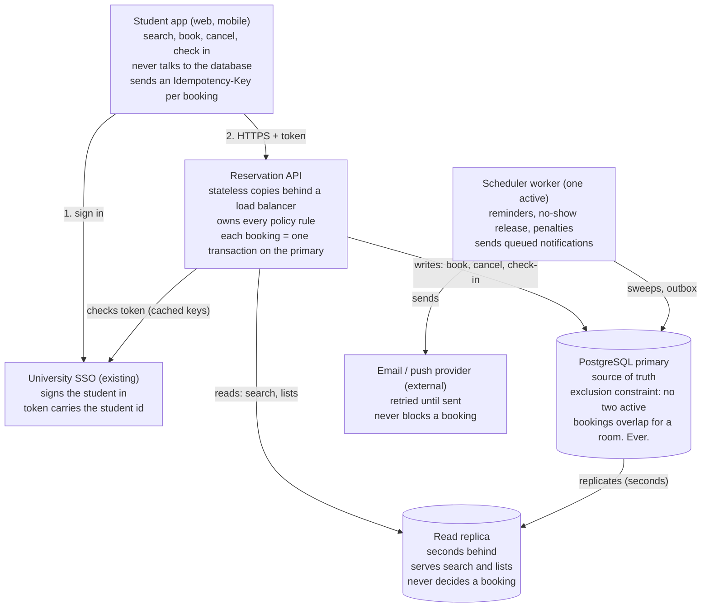

# System design

Six parts meet every requirement: the app, the existing SSO, one stateless API service, one PostgreSQL primary with a read replica, one background worker, and an external email and push provider. No cache, no message broker, no separate microservices.

The app only ever talks to the API. Writes go to the primary, where the overlap rule is a constraint. Search reads the replica, which is allowed to be a few seconds behind.

## Design questions answered

| Question | Answer |
| --- | --- |
| Smallest set of parts? | The six above. A cache, a broker or extra services would each add cost and failure modes that 300 rooms and 5 writes per second do not need. |
| Where does each rule live? | Overlap, one active booking per room, idempotency uniqueness and valid statuses: database constraints. Grid, duration, hours, horizon, weekly limit, suspension, check-in window, allowed state changes: the API service, reading the policy table. No-show, completion and penalties: the worker. Each rule has exactly one owner. |
| What does each part own and never touch? | **App:** screens and the idempotency key; never the database. **SSO:** identity; knows nothing of bookings. **API:** all reads and student-driven writes; never sends email directly. **Primary:** all state. **Replica:** read-only copy; never decides a booking. **Worker:** time-driven changes and sending; never takes student requests. **Provider:** delivery only. |
| Does the client talk to the database? | Never. The API is the only gatekeeper. |
| Reads vs writes? | Reads: search, available soon, just released, my bookings, my standing, announcements (replica). Writes: book, cancel, check in (primary), plus worker sweeps. |
| How does the service know the student? | The app sends the SSO token. The API checks its signature with cached SSO keys and takes `student_id` from the token only. A student id in the body is ignored. |
| Two requests for the same room at the same moment? | Both reach the primary; the exclusion constraint lets exactly one insert commit. The other gets a constraint error, which the API returns as 409 `SLOT_TAKEN`. The weekly limit is checked with the student row locked (`SELECT ... FOR UPDATE`) in the same transaction, so two parallel bookings by one student cannot both slip under the limit. |
| Repeated request (double click, retry)? | The app sends one Idempotency-Key per booking attempt. A unique index on `(student_id, key)` means a repeat returns the stored booking instead of creating another. Cancel and check-in are naturally repeat-safe: repeating them on the same booking returns the same result. |
| Which parts hold state? | Stateful: primary, replica, provider. Stateless: app, API copies, worker (it keeps no memory between runs; a database advisory lock keeps one copy active, so a standby can take over). |

## Failure behaviour

| Part down | What the user sees |
| --- | --- |
| One API copy | The load balancer routes around it; nothing visible. |
| All API copies | App shows "Service unavailable" and cached My bookings. |
| Primary | Search works from the replica with a "booking paused" banner; book, cancel and check-in return 503. |
| Replica | Search falls back to the primary, slower but correct. |
| Worker | Bookings work; reminders and no-show releases are late and catch up on restart. |
| Provider | Bookings work; emails queue in the outbox. |
| SSO | Signed-in students keep working until their token expires; new sign-ins fail. |
| Planned downtime | Announced 24 h ahead by notification and banner. |
